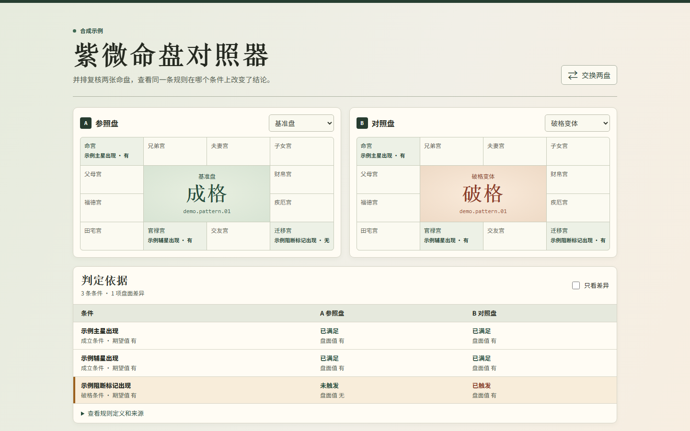

# 紫微命盘对照器 · Zi Wei Chart Debugger

并排查看两张合成命盘，复核同一条规则为何判出不同结论。浏览器演示、命令行和测试共用一个 TypeScript 规则引擎。



## 运行演示

在 Node.js 22.18+ 的 22.x 版本或 Node.js 24+ 的环境中运行以下命令，打开终端显示的本地网址。

```sh
npm ci
npm run dev
```

默认比较基准盘和只改了一项字段的破格变体。可以独立选择左右案例、交换两盘、只看差异，或展开规则定义和来源。

## 可复核的示例

| 案例 | 相对基准盘的变化 | 预期结果 |
| --- | --- | --- |
| 基准盘 | 两项成立条件齐备，破格条件未触发 | 成格 |
| 破格变体 | 迁移宫的示例阻断标记从无变为有 | 破格 |
| 资料缺失变体 | 官禄宫的示例辅星字段未录入 | 资料不足 |
| 成立条件未满足 | 官禄宫的示例辅星明确为无 | 未成格 |
| 破格字段未录入 | 迁移宫的示例阻断标记未知 | 资料不足 |

公开盘面、规则与来源标识使用合成数据。此演示的验证范围是软件能否复现预设条件及其判定链。

## 实现与数据格式

- [界面](src/main.tsx)使用 React、TypeScript 和 Vite。十二宫图标出当前规则涉及的宫位，表格对照每项条件的期望、盘面值和结果。
- [规则引擎](src/rules.ts)返回规则 ID、来源引用、最终状态和全部条件记录。成立条件必须全部满足，任一已满足的破格条件会触发破格。未录入字段独立标记为未知。
- [规则 Schema](rule.schema.json)使用 JSON Schema 2020-12，定义版本、稳定 ID、来源标识、成立条件和破格条件。[合成规则](example-rule.json)是界面实际读取的 JSON，[合成盘](src/examples.ts)提供示例输入。

## 构建与测试

```sh
npm run build
npm test
npx playwright install chromium
npm run test:e2e
```

Vitest 验证五种判定、条件记录与 JSON Schema。Playwright 验证双盘切换、差异筛选、来源展开，以及窄屏下的操作。也可以直接运行 `node --test ziwei-rule-demo.ts`，复现最初提交审核的五项命令行测试。
